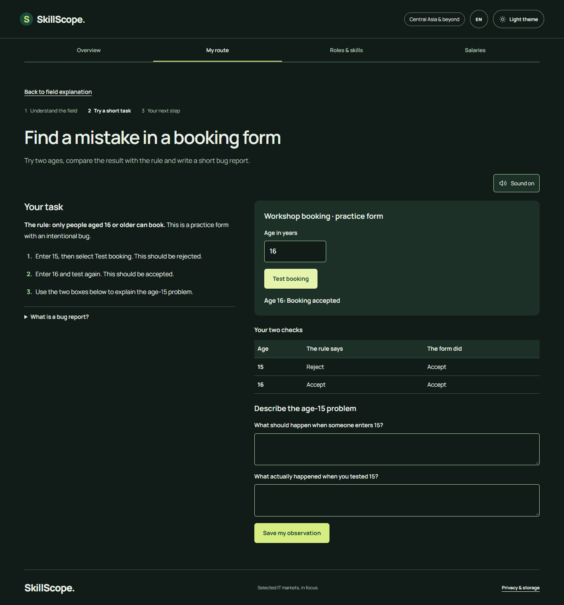

# SkillScope

**Try the work before choosing an IT direction.** As AI changes the industry,
beginners need more than job titles and lists of skills to choose a path.
SkillScope lets them try Data analysis, Web development or Software testing,
then check what vacancies in their market actually mention.

[Try SkillScope](https://skillscope-uedt.onrender.com/) ·
[Explore My route](https://skillscope-uedt.onrender.com/#route)

## Try a field, then look at the evidence

For example, choose **Software testing**: learn what testers do, find a bug in
a small browser exercise and decide what to learn next. Then inspect vacancy
requirements in your country. Data analysis and Web development have their own
guided tasks. No account or setup is needed.

Vacancy data adds context to a choice; it does not predict whether someone
will get a job or how AI will change a field.

## About the data

The site uses anonymised HeadHunter search results for ten IT roles
across seven configured markets. Coverage varies by country. These searches
do not represent the whole job market; the site shows snapshot dates and
sample sizes beside its findings.

Read the [data card](docs/data-card.md) for scope and limitations, or the
[manual validation note](docs/validation-2026-10-10.md) for an example of how
the classification was checked.

## Built with

Python, FastAPI and SQLite for collection and the API; React, TypeScript and
Vite for the interface. See [local development](docs/local-development.md)
and the [weekly collection guide](docs/weekly-collection.md) for setup details.
