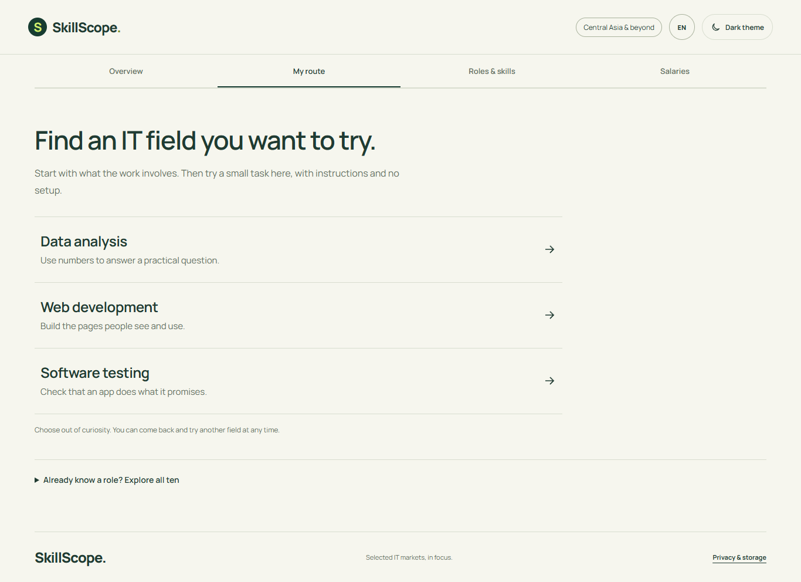

# SkillScope

A tool for beginners asking **which IT direction should I try, and what can I do
first?** Compare three kinds of work, try a small exercise and leave with a concrete
next step. HeadHunter vacancy evidence adds country-specific context across Central
Asia, Georgia and Russia.

**[Open the public demo](https://skillscope-uedt.onrender.com/)** ·
[Data and limitations](docs/data-card.md) ·
[Method and validation](docs/validation-2026-10-10.md)



*Local My route capture, 14 October 2026. The public demo follows its last deployment.*

## What the project does

- Opens with three fields explained in ordinary language: Data analysis, Web
  development and Software testing. Visitors read one field guide at a time,
  try a short task and save a next learning step. There is no aptitude quiz.
- Provides all practice tools in the browser: check a small sales table, edit
  HTML with a preview, or test an age rule and record a bug. Instructions, worked
  examples and feedback support each task. Vacancy figures and deeper topics are
  optional. [Guide design and sources](docs/career-guides.md).
- Collects HeadHunter vacancies for ten configured roles in five IT fields across
  seven markets. The weekly local workflow audits, collects and saves dated snapshots.
- Uses explicit title rules and a versioned skill dictionary to classify vacancies;
  keeps exclusions and ambiguous seniority reviewable.
- Lets visitors filter vacancy counts, skill mentions, experience signals and
  advertised salaries by market, field and role. All ten roles remain available in
  My route's expandable skill exploration section.
- Shows denominators and missing coverage alongside comparisons. One salary table
  shows country, role and all published formats, each with its vacancy count below.
  It starts with all experience levels, offers a no-experience filter and anonymised examples
  with salary, experience requirements and skill mentions. [Salary guide](docs/salary-guide.md).
  The optional USD view uses dated exchange rates. Country lists follow
  the latest snapshot's vacancy counts, largest first.

The packaged **12 October 2026** demo includes 2,297 of 2,541 collected candidates
across Kyrgyzstan, Kazakhstan, Uzbekistan, Georgia and Russia. Tajikistan and
Turkmenistan had no matching configured roles in this run. Russia contributes 1,925
vacancies (84%) to the combined view, so country comparisons use each country's own
denominator. Only 263 included vacancies have complete salary ranges. These are
HeadHunter search results for configured terms, not estimates of all IT hiring.

**How to review the work:** start with the [data card](docs/data-card.md) for scope
and limitations, the [validation note](docs/validation-2026-10-10.md) for a manual
check of an earlier snapshot, and the [weekly collection design](docs/weekly-collection.md)
for the refresh and recovery process. The dashboard has Overview, My route, Roles &
skills and Salaries tabs. The 2026-10-10 manual review does not validate the newer
2026-10-12 snapshot.

## Run the dashboard

Requirements: Python 3.12 or newer.

```powershell
python -m venv .venv
.\.venv\Scripts\python.exe -m pip install -e ".[api]"
.\.venv\Scripts\python.exe -m skillscope.serve
```

Open `http://127.0.0.1:8000`. The app uses `data/processed/vacancies_latest.jsonl` when present; otherwise it serves the sanitized snapshot packaged with the project. The demo snapshot omits vacancy IDs, titles, employers, links and descriptions.

The header theme control switches between light and dark. A first visit uses dark;
an explicit choice is saved in browser storage. Task completion sound is enabled
by default and can be muted. Mr. Scope sends on Enter; Shift+Enter adds a new line.
Mr. Scope turns the current vacancy aggregates into short answers from any dashboard tab.
It needs a server-side `GROQ_API_KEY`; without one, the dashboard remains usable and
Mr. Scope shows that answers are unavailable. See [deployment setup](docs/deployment.md).

## Configuration

The dashboard works with demo data and does not need a HeadHunter token. Copy `.env.example` to `.env` only when collecting data:

```powershell
Copy-Item .env.example .env
```

Role categories, search phrases, title patterns and overlap priority live in
`src/skillscope/role_catalog.toml`. Skill aliases live in `config/skills.toml`.

| Variable | Purpose |
| --- | --- |
| `HH_USER_AGENT` | HeadHunter client identification; replace the example email with a contact email. |
| `HH_ACCESS_TOKEN` | Optional API token for collection; anonymous requests may be interrupted by captcha. |
| `HH_CLIENT_ID`, `HH_CLIENT_SECRET` | Credentials used by `python -m skillscope.auth` to obtain a token. |
| `HH_REQUEST_TIMEOUT_SECONDS` | Request timeout; default `20`. |
| `HH_MAX_RETRIES` | Maximum retries for temporary API failures; default `4`. |
| `GROQ_API_KEY` | Server-side key for Mr. Scope; never expose it as a frontend variable. |
| `HOST`, `PORT` | Web server bind address and port; defaults are `127.0.0.1` and `8000`. |

Never commit `.env`, raw API responses, full processed records or the local history database.

## Collect and process data

After setting a valid `HH_USER_AGENT` and HeadHunter credentials in `.env`:

```powershell
.\.venv\Scripts\python.exe -m skillscope.auth
.\.venv\Scripts\python.exe -m skillscope.audit
.\.venv\Scripts\python.exe -m skillscope.collect
.\.venv\Scripts\python.exe -m skillscope.eda
.\.venv\Scripts\python.exe -m skillscope.demo_data
```

Collection writes raw and processed files locally. Review the generated demo snapshot before committing it. The generator uses an explicit field allowlist.

## Historical storage

Each strict collection updates `data/processed/vacancy_history.sqlite3`. The database
deduplicates vacancies by market and HeadHunter ID, and observations by collection ID,
market and vacancy ID. It retains publication and collection timestamps, role, category,
seniority, experience, normalized skills and advertised salary fields for each observed
vacancy. Reprocessing the same collection updates its observation instead of adding a
duplicate. Earlier observations remain in place when later collections run.

Each processed run also writes a separate local JSONL snapshot under
`data/processed/snapshots/`; `vacancies_latest.jsonl` remains the dashboard input.
Collect all seven markets in one audit when you want a comparable seven-country view;
a selected-market run updates the dashboard's latest snapshot with only that selection.
Keep the SQLite database and snapshot directory in persistent storage and back them up.
They are gitignored and are not included in the packaged demo or an ephemeral deployment.
Run `python -m skillscope.audit` before `python -m skillscope.collect` for each new
collection. Collection defaults to the markets present in its audit report, so older
three-market reports remain reprocessable. The demo shows the 2026-10-12 snapshot,
not a trend estimate.

For a weekly Windows Task Scheduler run with a local recovery copy, follow
[`docs/weekly-collection.md`](docs/weekly-collection.md). The scheduled task uses the
HeadHunter API token from `.env` and requires the computer to be on with the configured
Windows user logged in.

The first five-market audit is in `artifacts/reports/feasibility_five_markets_20261010.json`.
The latest classification summary is `artifacts/reports/classification_latest.json`. The
private review worksheet is `data/processed/manual_review_latest.csv`. The bundled demo
retains only the twelve allowlisted analytical fields, without vacancy identity or text.
The [2026-10-10 validation note](docs/validation-2026-10-10.md) records the stratified
manual review, corrected role classification and skill-dictionary additions.

## Frontend development

Requirements: Node.js 22.18 or newer and pnpm. Run the API with `python -m skillscope.serve`, then in another terminal:

```powershell
pnpm --dir frontend install --frozen-lockfile
pnpm --dir frontend dev
```

The Vite server runs the development UI and proxies `/api` to FastAPI. To update the dashboard bundle served by FastAPI:

```powershell
pnpm --dir frontend build
```

Commit the regenerated files in `src/skillscope/static` with the frontend changes.

The dashboard has four tabs: Overview, My route (the default entry), Roles & skills,
and Salaries. Beginner guides, reflections and plan downloads work independently of
vacancy evidence; country counts and skill mentions refresh from the deployed snapshot.
The expandable advanced section compares two sampled roles across markets, then uses
the current snapshot to list up to five frequently mentioned skills the visitor has not
marked as known for that scope and role. The combined view mixes countries unevenly.
Counts, observation date
and small-sample warnings stay visible; known skills are saved only in the browser.
Shared filters persist across tabs. Market Radar previews and pins skill frequencies and
offers keyboard navigation, a List view and reduced-motion support.
The combined sample shows each country's contribution before aggregate findings; the
country skill comparison uses each country's own vacancy count and updates with the snapshot.

## Checks

Install Python development tools with `pip install -e ".[dev]"`, then run:

```powershell
python -m pytest
python -m ruff check src tests
python -m mypy src/skillscope
pnpm --dir frontend test
pnpm --dir frontend build
pnpm --dir frontend exec playwright install chromium
```

With the API server running, use `pnpm --dir frontend test:browser` and
`node frontend/tests/radar-interactions.cjs`. The beginner flow is checked with
`node frontend/tests/career-route.cjs` (including sound and reduced-motion feedback).
Country ordering and salary details/conversion are checked with
`node frontend/tests/ui-refinements.cjs`; experience filtering and real vacancy
examples with `node frontend/tests/salary-examples.cjs`. Set `PLAYWRIGHT_CHANNEL=chrome` to use
installed Chrome instead, or `SKILLSCOPE_URL` to check another local server.

## API

- `GET /api/overview`
- `GET /api/taxonomy`
- `GET /api/roles?market=kz&category=software_engineering`
- `GET /api/skills?market=kz&role=data_analyst`
- `GET /api/salaries`
- `GET /api/salaries?experience=noExperience`
- `GET /api/salary-examples?market=ru&role=data_analyst&currency=RUB&experience=noExperience`
- `GET /api/seniority`
- `GET /api/model-insights`

Interactive API documentation is available at `/docs`.

## Scope and limitations

- Search results are a HeadHunter snapshot, not a census of the regional labour market.
- The 2026-10-10 strict search found no matching configured roles in Tajikistan or
  Turkmenistan on HeadHunter. This does not establish zero IT hiring there. Their
  zero counts in the demo mean no matching vacancy in this snapshot.
- Role counts describe vacancies returned by configured searches; they are not total
  market demand. Categories with few records should not be ranked as if samples were equal.
- Role and skill assignments use explicit rules and dictionaries.
- Seniority is inferred from titles, descriptions and experience bands.
- Salary values are sparse. Only complete local-currency ranges contribute a midpoint. Groups are not pooled across currencies; the salary page optionally shows approximate USD values using saved, dated Frankfurter rates and identifies each group's original currency. Summaries include different experience levels and are not junior salary expectations.
- No salary prediction model has been trained.

## Stack

Python, FastAPI, SQLite, React, TypeScript and Vite. The deployment configuration for Render is in `render.yaml`; see [deployment instructions](docs/deployment.md).
